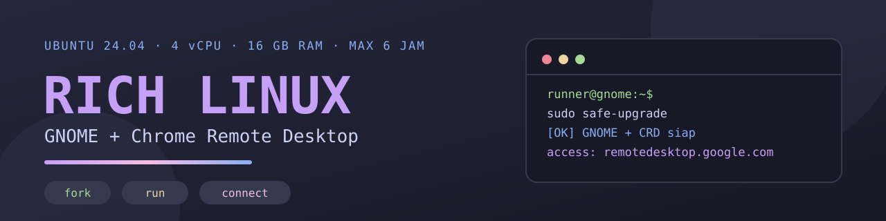

<p align="center">
  
</p>

<p align="center">
  <a href="https://github.com/ArchDityaa/gnome-crd/actions/workflows/lint.yml"></a>
  <a href="https://github.com/ArchDityaa/gnome-crd/blob/main/LICENSE"></a>
  
  
  
  
  
  
</p>

Run a **full GNOME desktop** in the cloud, for free, just by **forking this repo**.
Connect from your browser via Chrome Remote Desktop — nothing to install locally.

[Versi Bahasa Indonesia →](README.md)

## 📋 Table of Contents

- [Good for](#good-for)
- [At a glance](#at-a-glance)
- [What you get](#what-you-get)
- [Desktop variants](#desktop-variants)
- [Requirements](#requirements)
- [Usage (5 steps)](#usage-5-steps)
- [After you connect](#after-you-connect)
- [Limitations & important notes](#limitations--important-notes)
- [Quick troubleshooting](#quick-troubleshooting)
- [Repository layout](#repository-layout)
- [Contributing](#contributing)
- [Credits](#credits)

---

Good for:

- Experimenting with the GNOME desktop environment (extensions, themes, layouts)
- Testing and running GUI tools (VS Code, Chrome, virt-manager, GNOME Boxes)
- Trying Linux applications in a clean, disposable environment
- Learning the terminal and Linux without risking your own machine

## At a glance

```mermaid
flowchart LR
    classDef action fill:#bbf,stroke:#f66,stroke-width:2px,color:#fff,font-weight:bold;
    classDef desktop fill:#dfd,stroke:#6f6,stroke-width:2px,color:#222;
    classDef access fill:#fdf,stroke:#f6f,stroke-width:2px,color:#222;

    A[Fork repo]:::action
    A --> B[Enable Actions]:::action
    B --> C[Run Workflow<br/>no auth input]:::action
    C --> D[ubuntu-26.04 Runner<br/>GNOME / Cinnamon + Chrome]:::desktop
    D --> E[Form URL via<br/>Cloudflare Tunnel]:::action
    E --> F[Authorize at<br/>remotedesktop.google.com]:::access
    F --> G[Paste Debian<br/>Command into Form]:::action
    G --> H[Device Registered<br/>'gnome' / 'cinnamon']:::desktop
    H --> I[Connect from Browser]:::access
    I --> J[GNOME / Cinnamon Desktop<br/>up to 6 hours]:::desktop
```



> **Important:** you no longer get the Chrome Remote Desktop auth code at the
> start. The workflow waits until the desktop is ready, then shows a web form.
> The code you create after that is used immediately, so it will not expire
> during installation.

---

## What you get

One **Ubuntu 26.04** virtual machine (4 vCPU / 16 GB RAM) with a pre-configured
**GNOME** or **Cinnamon** desktop, alive for up to **6 hours**, then it shuts
down automatically. Every run is a clean environment — when it ends, it's gone.

| Pre-installed | Notes |
|---|---|
| 🖥️ **GNOME Desktop** | Full `ubuntu` GNOME session (not XFCE) — `GNOME 26` workflow |
| 🍄 **Cinnamon Desktop** | Cinnamon 6.4 X11 + Nemo + Muffin — `Cinnamon 26` workflow |
| 🌐 **Google Chrome** | Ready to sign in to your Google account |
| 💻 **VS Code** | `code` |
| 💡 **OpenCode CLI + Desktop** | CLI at `/usr/local/bin/opencode`, plus the desktop app |
| 🔗 **Chrome Remote Desktop** | The main access path |
| 🖥️ **virt-manager + libvirt/QEMU** | For running VMs inside (nested). GNOME also includes GNOME Boxes |
| 🎨 **Catppuccin Macchiato + Mauve** | GTK/Cinnamon Shell theme, Papirus icons, cursors, JetBrainsMono Nerd Font |
| 🔒 **safe-upgrade** | A drop-in replacement for `apt upgrade` that won't kill your session |

Plus: timezone **Asia/Jakarta (WIB)**, screensaver & lock disabled, Catppuccin
wallpaper, and desktop shortcuts.

### Desktop variants

| | **🖥️ GNOME 26** | **🍄 Cinnamon 26** |
|---|---|---|
| Workflow | `.github/workflows/gnome26.yml` | `.github/workflows/cinnamon.yml` |
| Desktop | GNOME (`ubuntu` session) | Cinnamon 6.4 (`cinnamon` session, X11) |
| CRD device | `gnome` | `cinnamon` |
| File manager | Nautilus | Nemo |
| Note | Animations forced on via an extension | Animations may stay off because Cinnamon disables effects under software rendering (llvmpipe) |

Both use the `ubuntu-26.04` runner, user `runner`, and the same web authorization
flow. Pick either workflow when you run Actions.

---

<!-- SCREENSHOTS: this block is commented out until real images exist.
     How to capture and upload: docs/adding-screenshots.md
     Once the files are in docs/images/, remove the opening comment line
     along with the closing line, then uncomment each  tag.

     Images needed:
       - docs/images/desktop.png   — GNOME/Cinnamon desktop with Catppuccin theme
       - docs/images/overview.png  — GNOME overview / Activities
       - docs/images/apps.png      — VS Code and Chrome running in the CRD session
       - docs/images/safe-upgrade.png — Running sudo safe-upgrade
-->

## Requirements

- A **GitHub** account (free). Public repos get unlimited Actions minutes.
- A **Google** account (for Chrome Remote Desktop).
- Chrome/Chromium (to open the Remote Access page).
- No Cloudflare account — the workflow creates a quick tunnel automatically.

No credit card, no server, no self-hosted runner.

---

## Usage (5 steps)

### 🍴 1. Fork this repository

Click **Fork** (top right) → **Create fork**.

### ⚙️ 2. Enable Actions on your fork

**This is the step people most often miss.** GitHub disables workflows on forks.

> **Settings** → **Actions** → **General** → select **Allow all actions and
> reusable workflows** → **Save**.

### 🚀 3. Run the workflow (no auth input)

1. Open the **Actions** tab in your fork.
2. Select **GNOME 26** or **Cinnamon 26** in the left sidebar.
3. Click **Run workflow** (top right).
4. Leave **crd_host_command** **empty** — it is only a fallback.
5. Click the green **Run workflow**.

**Optional — change the PIN:** add a `CRD_PIN` secret under
**Settings → Secrets and variables → Actions → New repository secret**
(value: at least 6 digits). If unset, the default PIN is `123456`.

### 🔐 4. Open the auth form and authorize

After installation finishes (**~20–40 minutes**), the log shows:

```
[OK] FORM OTORISASI SIAP
```

The form URL also appears in the run's **Job Summary**. Open it (from your phone
or another network is fine). If Cloudflare shows **1033/502**, wait ~15 seconds
and refresh — the tunnel is warming up.

Then:

1. In another tab, open <https://remotedesktop.google.com/headless> and sign in
   to your Google account.
2. Click **Begin** → **Next** → **Authorize**.
3. Under **"Set up another computer" / "Debian Linux"**, copy the **ENTIRE**
   command shown. It looks like:

   ```bash
   DISPLAY= /opt/google/chrome-remote-desktop/start-host --code="4/0Ab..." --redirect-url="https://remotedesktop.google.com/_/oauthredirect" --name=$(hostname)
   ```

4. Paste that command into the form and submit.

The form shows live status. If registration fails (wrong, expired, or already
used code), get a **NEW code** from the headless page and submit it again in the
same form — **no workflow re-run needed** while the 30-minute window is open.

The form has been refreshed: responsive two-column layout, Catppuccin
**Auto / Light / Dark** theme (top-right button), and an **ID / EN** language
toggle. A 4-step guide, status, countdown, progress bar, and command validation
are shown inline. Use **Paste**, **Clear**, or **Copy device name** to fill it
faster, and <kbd>Ctrl</kbd>/<kbd>Cmd</kbd>+<kbd>Enter</kbd> to submit. Commands
and OAuth codes are **not** stored in the browser; only the language/theme
preferences (`crd.lang`, `crd.theme`) are saved in `localStorage`.

> **Do not share the form URL.** It contains a random token and acts as a
> temporary credential for about 30 minutes.

### 🔗 5. Wait & connect

Once the log shows:

```
[OK] CHROME REMOTE DESKTOP READY
```

open <https://remotedesktop.google.com/access>, pick the device named **gnome**
(GNOME workflow) or **cinnamon** (Cinnamon workflow), and enter the PIN.

| | |
|---|---|
| **User** | `runner` (password: `root`) |
| **PIN** | `123456` (or your `CRD_PIN` secret) |
| **Device** | `gnome` / `cinnamon` (depending on the workflow) |
| **Duration** | up to ~6 hours, then the VM is shut down automatically |

> The legacy **`gnome.yml`** workflow (RICH LINUX, Ubuntu 24.04) uses the old
> flow: get the CRD command **before** running, then paste it into
> `crd_host_command`. For the latest flow, use **GNOME 26** or **Cinnamon 26**.

---

## After you connect

- 🖥️ **Terminal:** press <kbd>Super</kbd> → search *Terminal*, or use the panel/dash icon.
- 📁 **File manager:** Nautilus on GNOME, **Nemo** on Cinnamon.
- 🔒 **Upgrade packages safely:**

  ```bash
  sudo safe-upgrade
  ```

  There is also a **Safe Upgrade** shortcut on the Desktop. **Do not** run plain
  `sudo apt upgrade -y` — it can restart Chrome Remote Desktop and drop your
  session.
- 🖥️ **Run VMs (KVM):** use `virt-manager` (both variants), or **GNOME Boxes** on
  GNOME. x86 runners have KVM, so VMs run with hardware acceleration.
- 🎨 **Theme:** Catppuccin Macchiato (Mauve) is already active. On Cinnamon, change
  it via **Themes** → *Desktop*; if `cinnamon.css` misbehaves, restore the
  built-in theme with `gsettings set org.cinnamon.theme name ''`.

---

> ⚠️ **Important Security Notice**
>
> The authorization form URL contains a **random 128-bit token** that acts as a
> temporary credential for about 30 minutes. Anyone who opens that URL during
> the 30-minute window can submit a registration command. **Do not share the
> URL**, and close the form tab when done. If you are using a **public repo**,
> logs and the **Job Summary** are also visible to anyone while the run is active.
> If that is a concern, use a **private fork**.

## Limitations & important notes

- **6 hours per run, maximum.** This is the GitHub-hosted job limit. Plan your
  work and push results elsewhere, because the VM is destroyed afterwards.
- **Disposable instance.** Nothing persists between runs.
- **30-minute auth window.** After the desktop is ready, the web form accepts a
  command for 30 minutes only. If it expires, the workflow fails and must be
  re-run (the `.deb` cache makes re-runs faster).
- **Cloudflare quick tunnels have no SLA.** The URL is random and may need a
  refresh on first open. If the tunnel dies, the workflow tries to restart it up
  to 3 times and prints a new URL.
- **Use within GitHub Actions ToS.** GitHub permits Actions for *production,
  testing, deployment, or publication* of software. This repo is intended for
  **experiments and tool testing**; don't use it as general-purpose hosting or
  for crypto mining.
- **Credential safety:**
  - The form URL contains a **random 128-bit token**. Anyone who opens that URL
    during the 30-minute window can submit a registration command. **Do not
    share the URL**, and close the form tab when done.
  - On a **public** repo, logs and the **Job Summary** are also visible to
    anyone while the run is active. If that is a concern, use a **private fork**.
  - The OAuth code (`--code=...`) is still **single-use**. It is created after
    the desktop is ready, so it won't expire during installation.
  - `crd_host_command` is an **optional fallback**. If you fill it at the start,
    the code may expire before registration; prefer the web form.
  - Change the default PIN `123456`. CRD access still requires your Google
    login, but a strong PIN is recommended.
- **Staying up to date:** forks don't auto-update. Use GitHub's **Sync fork**
  button to pull the latest fixes.

---

## Quick troubleshooting

| Problem | Cause & fix |
|---|---|
| Workflow missing from the Actions tab | Actions not enabled on the fork → **Settings → Actions → General → Allow all actions**. |
| Form URL does not appear | Check the **Authorize & Register Chrome Remote Desktop (Web UI)** step log. If you see `[FAIL] Cloudflare quick tunnel tidak bisa dibuat`, re-run the workflow (the `.deb` cache is reused), or re-run with `crd_host_command` filled as a fallback using a fresh code. |
| Cloudflare 1033/502 on the form page | The tunnel is warming up. Wait ~15 seconds and refresh. If it still fails, wait for a new URL in the log (the workflow restarts the tunnel automatically). |
| Registration through the form fails | The OAuth code expired or was already used. Get a **fresh** command at <https://remotedesktop.google.com/headless>, then submit it again in the same form. No re-run needed while the 30-minute window is open. |
| The 30-minute window expired | The workflow stops. Re-run it; the `.deb` cache makes installation much faster. |
| Device not shown in Remote Access | Wait until the log shows `[OK] CHROME REMOTE DESKTOP READY`. If it's still missing, refresh the page and check `systemctl status chrome-remote-desktop@runner`. |
| Session drops while updating packages | You used plain `apt upgrade`. Use `sudo safe-upgrade`. |
| Odd resolution / small screen | Locked to `1024x768` (native `dummy` driver mode). Adjust via *Settings → Displays*. |
| `virt-manager`: libvirt "Permission denied" | Log out and back in to the desktop session, or run VMs via GNOME Boxes (GNOME variant). |
| Cinnamon: black screen after connecting | Try the `cinnamon2d` fallback: change the `exec` line in `~/.chrome-remote-desktop-session` to `exec /usr/bin/cinnamon-session --session cinnamon2d`, then restart `chrome-remote-desktop@runner`. |
| Cinnamon: animations don't run | Expected in the CRD session: Cinnamon 6.4 disables effects when it detects software rendering (llvmpipe). There is no `force_animations` override like GNOME Shell has. |
| `Cannot access KVM` | KVM is available on x86 runners. Check `ls -l /dev/kvm`; if it exists but still fails, open an issue with the run log. |

Full guide: [`docs/troubleshooting.md`](docs/troubleshooting.md) ·
FAQ: [`docs/faq.md`](docs/faq.md) ·
How to add screenshots: [`docs/adding-screenshots.md`](docs/adding-screenshots.md)

---

## Repository layout

```
.
├── .github/
│   ├── workflows/
│   │   ├── gnome26.yml          # main GNOME workflow (web auth form)
│   │   ├── cinnamon.yml         # Cinnamon 26 workflow (X11, device 'cinnamon')
│   │   ├── gnome.yml            # legacy workflow (command at start)
│   │   └── lint.yml             # CI: actionlint + yamllint + shellcheck
│   ├── ISSUE_TEMPLATE/
│   └── dependabot.yml
├── scripts/
│   ├── crd-web-auth.py          # auth form server (token + status)
│   └── safe-upgrade.sh          # session-safe upgrade helper
├── docs/
│   ├── images/banner.svg
│   ├── adding-screenshots.md
│   ├── troubleshooting.md
│   └── faq.md
├── .yamllint.yml                # YAML linter configuration
├── README.md                    # Indonesian
├── README.en.md                 # this file
├── CHANGELOG.md
└── LICENSE
```

---

## Contributing

Pull requests are very welcome. All YAML, workflows and shell scripts are
validated automatically by the **Lint** CI on every push to `main` and every
pull request.

Run the same linters locally before pushing:

```bash
pip install yamllint
yamllint .
shellcheck scripts/*.sh
python3 -m py_compile scripts/crd-web-auth.py
# actionlint: https://github.com/rhysd/actionlint
actionlint -ignore SC2016 -ignore SC2034 -ignore SC2012 \
  -ignore 'label "ubuntu-26.04" is unknown'
```

---

## Credits

- [Catppuccin](https://github.com/catppuccin) — GTK theme, cursors, terminal, wallpaper
- [Papirus](https://github.com/PapirusDevelopmentTeam/papirus-icon-theme) — icon theme
- [Nerd Fonts](https://github.com/ryanoasis/nerd-fonts) — JetBrainsMono
- Google Chrome Remote Desktop

License: [MIT](LICENSE).
