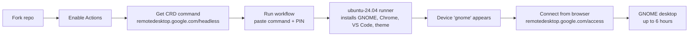

<p align="center">
  
</p>

<p align="center">
  <a href="https://github.com/ArchDityaa/gnome-crd/actions/workflows/lint.yml"></a>
  <a href="https://github.com/ArchDityaa/gnome-crd/blob/main/LICENSE"></a>
  
  
  
  
</p>

Run a **full GNOME desktop** in the cloud, for free, just by **forking this repo**.
Connect from your browser via Chrome Remote Desktop — nothing to install locally.

[Versi Bahasa Indonesia →](README.md)

Good for:

- Experimenting with the GNOME desktop environment (extensions, themes, layouts)
- Testing and running GUI tools (VS Code, Chrome, virt-manager, GNOME Boxes)
- Trying Linux applications in a clean, disposable environment
- Learning the terminal and Linux without risking your own machine

## At a glance



---

## What you get

One **Ubuntu 24.04** virtual machine (4 vCPU / 16 GB RAM) with a pre-configured
GNOME desktop, alive for up to **6 hours**, then it shuts down automatically.
Every run is a clean environment — when it ends, it's gone.

| Pre-installed | Notes |
|---|---|
| **GNOME Desktop** | Full `ubuntu` GNOME session (not XFCE) |
| **Google Chrome** | Ready to sign in to your Google account |
| **VS Code** | `code` |
| **OpenCode CLI + Desktop** | CLI at `/usr/local/bin/opencode`, plus the desktop app |
| **Chrome Remote Desktop** | The main access path |
| **virt-manager + GNOME Boxes + libvirt/QEMU** | For running VMs inside (nested) |
| **Catppuccin Macchiato + Mauve** | GTK/Shell theme, Papirus icons, cursors, JetBrainsMono Nerd Font |
| **safe-upgrade** | A drop-in replacement for `apt upgrade` that won't kill your session |

Plus: timezone **Asia/Jakarta (WIB)**, screensaver & lock disabled, GNOME
animations enabled on software rendering, Catppuccin wallpaper, and desktop
shortcuts.

---

<!-- SCREENSHOTS: this block is commented out until real images exist.
     How to capture and upload: docs/adding-screenshots.md
     Once the files are in docs/images/, remove the opening comment line
     along with the closing line.

## Screenshots

<p align="center">
  
  <br><em>GNOME desktop — Catppuccin Macchiato + Mauve</em>
</p>

<p align="center">
  
  
  <br><em>Overview (animations enabled) and pre-installed apps</em>
</p>

<p align="center">
  
  <br><em><code>sudo safe-upgrade</code> — upgrade without dropping the session</em>
</p>

-->

## Requirements

- A **GitHub** account (free). Public repos get unlimited Actions minutes.
- A **Google** account (for Chrome Remote Desktop).
- Chrome/Chromium (to open the Remote Access page).

No credit card, no server, no self-hosted runner.

---

## Usage (5 steps)

### 1. Fork this repository

Click **Fork** (top right) → **Create fork**.

### 2. Enable Actions on your fork

**This is the step people most often miss.** GitHub disables workflows on forks.

> **Settings** → **Actions** → **General** → select **Allow all actions and
> reusable workflows** → **Save**.

### 3. Get your Chrome Remote Desktop command

1. Open <https://remotedesktop.google.com/headless> (sign in with Google).
2. Click **Begin** → **Next** → **Authorize**.
3. Under **"Set up another computer" / "Debian Linux"**, copy the **ENTIRE**
   command shown. It looks like:

   ```bash
   DISPLAY= /opt/google/chrome-remote-desktop/start-host --code="4/0Ab..." --redirect-url="https://remotedesktop.google.com/_/oauthredirect" --name=$(hostname)
   ```

   > **Important:** the `--code=...` value is **single-use** and expires quickly.
   > Do not wait before pasting and running step 4.

### 4. Run the workflow

1. Open the **Actions** tab in your fork.
2. Select **RICH LINUX (GNOME + Chrome Remote Desktop)** in the left sidebar.
3. Click **Run workflow** (top right).
4. Paste the entire command from step 3 into the **crd_host_command** field.
5. Click the green **Run workflow**.

**Optional — change the PIN:** add a `CRD_PIN` secret under
**Settings → Secrets and variables → Actions → New repository secret**
(value: at least 6 digits). If unset, the default PIN is `123456`.

### 5. Wait & connect

Installation takes **~20–40 minutes** (the first run is the slowest; later runs
are faster thanks to the `.deb` cache). Once the log shows:

```
[OK] CHROME REMOTE DESKTOP READY
```

open <https://remotedesktop.google.com/access>, pick the device named **gnome**,
and enter the PIN.

| | |
|---|---|
| **User** | `runner` (password: `root`) |
| **PIN** | `123456` (or your `CRD_PIN` secret) |
| **Device** | `gnome` |
| **Duration** | up to ~6 hours, then the VM is shut down automatically |

---

## After you connect

- **Terminal:** press <kbd>Super</kbd> → search *Terminal*, or use the dash icon.
- **Upgrade packages safely:**

  ```bash
  sudo safe-upgrade
  ```

  There is also a **Safe Upgrade** shortcut on the Desktop. **Do not** run plain
  `sudo apt upgrade -y` — it can restart Chrome Remote Desktop and drop your
  session.
- **Run VMs (KVM):** use `virt-manager` or **GNOME Boxes**. x86 runners have
  KVM, so VMs run with hardware acceleration.
- **Theme:** Catppuccin Macchiato (Mauve) is already active. Change flavors via
  **Tweaks** → Appearance.

---

## Limitations & important notes

- **6 hours per run, maximum.** This is the GitHub-hosted job limit. Plan your
  work and push results elsewhere, because the VM is destroyed afterwards.
- **Disposable instance.** Nothing persists between runs.
- **Use within GitHub Actions ToS.** GitHub permits Actions for *production,
  testing, deployment, or publication* of software. This repo is intended for
  **experiments and tool testing**; don't use it as general-purpose hosting or
  for crypto mining.
- **Credential safety:**
  - The `crd_host_command` is visible in the run metadata (the `--code=...` is
    single-use, so the risk is low). If you'd rather not expose it, make your
    fork **private** (private Actions consume your free minutes quota).
  - Change the default PIN `123456`. CRD access still requires your Google
    login, but a strong PIN is recommended.
- **Staying up to date:** forks don't auto-update. Use GitHub's **Sync fork**
  button to pull the latest fixes.

---

## Quick troubleshooting

| Problem | Cause & fix |
|---|---|
| Workflow missing from the Actions tab | Actions not enabled on the fork → **Settings → Actions → General → Allow all actions**. |
| Run fails at *Register Chrome Remote Desktop* | The OAuth code expired or was already used. Get a **fresh** command at <https://remotedesktop.google.com/headless>, then **Re-run** this workflow (the `.deb` cache makes re-runs much faster). |
| Device not shown in Remote Access | Wait until the log shows `[OK] CHROME REMOTE DESKTOP READY`. If it's still missing, refresh the page and check `systemctl status chrome-remote-desktop@runner`. |
| Session drops while updating packages | You used plain `apt upgrade`. Use `sudo safe-upgrade`. |
| Odd resolution / small screen | Locked to `1024x768` (native `dummy` driver mode). Adjust via *Settings → Displays*. |
| `virt-manager`: libvirt "Permission denied" | Log out and back in to the GNOME session, or run VMs via GNOME Boxes. |
| `Cannot access KVM` | KVM is available on x86 runners. Check `ls -l /dev/kvm`; if it exists but still fails, open an issue with the run log. |

Full guide: [`docs/troubleshooting.md`](docs/troubleshooting.md) ·
FAQ: [`docs/faq.md`](docs/faq.md) ·
How to add screenshots: [`docs/adding-screenshots.md`](docs/adding-screenshots.md)

---

## Repository layout

```
.
├── .github/
│   ├── workflows/
│   │   ├── gnome.yml            # the main workflow you run
│   │   └── lint.yml             # CI: actionlint + yamllint + shellcheck
│   ├── ISSUE_TEMPLATE/
│   └── dependabot.yml
├── scripts/
│   └── safe-upgrade.sh          # session-safe upgrade helper
├── docs/
│   ├── images/banner.svg
│   ├── adding-screenshots.md
│   ├── troubleshooting.md
│   └── faq.md
├── .yamllint.yml                # YAML linter configuration
├── README.md                    # Indonesian
├── README.en.md                 # this file
├── CHANGELOG.md
└── LICENSE
```

---

## Contributing

Pull requests are very welcome. All YAML, workflows and shell scripts are
validated automatically by the **Lint** CI on every push to `main` and every
pull request.

Run the same linters locally before pushing:

```bash
pip install yamllint
yamllint .
shellcheck scripts/*.sh
# actionlint: https://github.com/rhysd/actionlint
actionlint -ignore SC2016 -ignore SC2034 -ignore SC2012
```

---

## Credits

- [Catppuccin](https://github.com/catppuccin) — GTK theme, cursors, terminal, wallpaper
- [Papirus](https://github.com/PapirusDevelopmentTeam/papirus-icon-theme) — icon theme
- [Nerd Fonts](https://github.com/ryanoasis/nerd-fonts) — JetBrainsMono
- Google Chrome Remote Desktop

License: [MIT](LICENSE).
