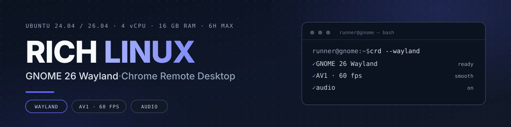
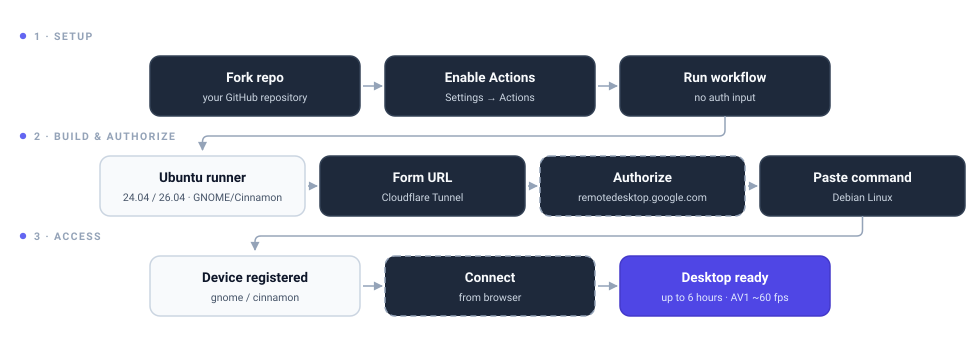

<p align="center">
  
</p>

<p align="center">
  <a href="https://github.com/ArchDityaa/gnome-crd/actions/workflows/lint.yml"></a>
  <a href="https://github.com/ArchDityaa/gnome-crd/blob/main/LICENSE"></a>
  
  
  
  
  
  
</p>

Run a **full GNOME desktop** in the cloud, for free, just by **forking this repo**.
Connect from your browser via Chrome Remote Desktop — nothing to install locally.

[Versi Bahasa Indonesia →](README.md)

> ✅ **Verified on 7 November 2026:** **GNOME 26 Wayland** runs smoothly
> through Chrome Remote Desktop — **AV1 video at ~60 fps**, PipeWire audio, and
> working animations. Details, evidence, and caveats:
> [**docs/wayland-crd.md**](docs/wayland-crd.md).

## Table of Contents

- [Good for](#good-for)
- [At a glance](#at-a-glance)
- [What you get](#what-you-get)
- [Desktop variants](#desktop-variants)
- [GNOME 26 Wayland (verified)](#gnome-26-wayland-verified)
- [Requirements](#requirements)
- [Usage (5 steps)](#usage-5-steps)
- [After you connect](#after-you-connect)
- [Limitations & important notes](#limitations--important-notes)
- [Quick troubleshooting](#quick-troubleshooting)
- [Repository layout](#repository-layout)
- [Contributing](#contributing)
- [Credits](#credits)

---

## Good for

- Experimenting with the GNOME desktop environment (extensions, themes, layouts)
- Testing and running GUI tools (VS Code, Chrome, virt-manager, GNOME Boxes)
- Trying Linux applications in a clean, disposable environment
- Learning the terminal and Linux without risking your own machine

## At a glance

<p align="center">
  
</p>

> **Important:** you no longer get the Chrome Remote Desktop auth code at the
> start. The workflow waits until the desktop is ready, then shows a web form.
> The code you create after that is used immediately, so it will not expire
> during installation.

---

## What you get

One **Ubuntu** virtual machine (4 vCPU / 16 GB RAM) with a pre-configured
**GNOME** or **Cinnamon** desktop, alive for up to **6 hours**, then it shuts
down automatically. Every run is a clean environment — when it ends, it's gone.
Runner is `ubuntu-24.04` for GNOME 24.04 & Cinnamon 26, and `ubuntu-26.04` for
GNOME 26 + CRD (Wayland BETA).

| Pre-installed | Notes |
|---|---|
| **GNOME Desktop** | Full `ubuntu` GNOME session (not XFCE) — `GNOME 24.04` workflow |
| **Cinnamon Desktop** | Cinnamon 6.4 X11 + Nemo + Muffin — `Cinnamon 26` workflow |
| **GNOME 26 Wayland (verified)** | Headless GNOME Shell 50 on Ubuntu 26.04, 1920x1080 virtual monitor, AV1/~60 fps video, PipeWire audio, animations on — [details](docs/wayland-crd.md) |
| **Google Chrome** | Ready to sign in to your Google account |
| **VS Code** | `code` |
| **OpenCode CLI + Desktop** | CLI at `/usr/local/bin/opencode`, plus the desktop app |
| **Chrome Remote Desktop** | The main access path |
| **virt-manager + libvirt/QEMU** | For running VMs inside (nested). GNOME also includes GNOME Boxes |
| **Catppuccin Macchiato + Mauve** | GTK/Cinnamon Shell theme, Papirus icons, cursors, JetBrainsMono Nerd Font (Cinnamon 26 & GNOME 24.04 workflows — the Wayland BETA workflow uses the default GNOME/Ubuntu theme with **automatic dark mode**) |
| **safe-upgrade** | A drop-in replacement for `apt upgrade` that won't kill your session |

Plus: timezone **Asia/Jakarta (WIB)**, screensaver & lock disabled. The
Cinnamon 26 **and** GNOME 24.04 workflows ship the Catppuccin wallpaper, full
theme, and a Safe Upgrade desktop shortcut. Only `GNOME 26 + CRD (Wayland
BETA)` is intentionally **vanilla** — default GNOME/Ubuntu: no third-party
themes, an empty desktop (no shortcuts), with **automatic dark mode**
(`color-scheme='prefer-dark'` + `gtk-theme='Yaru-dark'` for legacy GTK3 apps).
The Ubuntu wallpaper and look (Yaru + Ubuntu Sans) are set **explicitly via
dconf** with the dark variant `ubuntu-wallpaper-d.png`; this is required because
CRD forces GNOME Wayland sessions into `GNOME` mode, so `[schema:ubuntu]`
overrides never apply.

### Desktop variants

| | **GNOME 24.04** | **Cinnamon 26** |
|---|---|---|
| Workflow | `.github/workflows/gnome24.yml` | `.github/workflows/cinnamon.yml` |
| Desktop | GNOME (`ubuntu` session, X11) | Cinnamon 6.4 (`cinnamon` session, X11) |
| CRD device | `gnome` | `cinnamon` |
| File manager | Nautilus | Nemo |
| Note | Animations forced on via an extension | Animations may stay off because Cinnamon disables effects under software rendering (llvmpipe) |

### GNOME 26 Wayland (verified)

[`gnome26-wayland-beta.yml`](.github/workflows/gnome26-wayland-beta.yml) runs a
**headless GNOME Shell 50 Wayland** session on the `ubuntu-26.04` runner with a
`1920x1080` virtual monitor and a vanilla desktop. Verified on **7 November
2026** ([run 42378799566](https://github.com/ArchDityaa/gnome-crd/actions/runs/42378799566)):

- **AV1 video at ~60 fps** (adaptive to client/network),
- **audio** through the CRD PipeWire instance,
- **animations** enabled despite software rendering,
- keyboard/mouse input via Mutter RemoteDesktop/EI.

CRD's Wayland mode is still **experimental upstream**. If the screen goes
blank, wait 1–2 minutes and reconnect — the watchdog restarts the host
automatically. Full guide, architecture, and troubleshooting:
**[docs/wayland-crd.md](docs/wayland-crd.md)**.

GNOME 24.04 & Cinnamon 26 run on `ubuntu-24.04`; GNOME 26 Wayland runs on
`ubuntu-26.04`. User `runner` and the web authorization flow are the same.
Pick either workflow when you run Actions.

---

<!-- SCREENSHOTS: this block is commented out until real images exist.
     How to capture and upload: docs/adding-screenshots.md
     Once the files are in docs/images/, remove the opening comment line
     along with the closing line, then uncomment each  tag.

     Images needed:
       - docs/images/desktop.png   — GNOME/Cinnamon desktop with Catppuccin theme
       - docs/images/overview.png  — GNOME overview / Activities
       - docs/images/apps.png      — VS Code and Chrome running in the CRD session
       - docs/images/safe-upgrade.png — Running sudo safe-upgrade
-->

## Requirements

- A **GitHub** account (free). Public repos get unlimited Actions minutes.
- A **Google** account (for Chrome Remote Desktop).
- Chrome/Chromium (to open the Remote Access page).
- No Cloudflare account — the workflow creates a quick tunnel automatically.

No credit card, no server, no self-hosted runner.

---

## Usage (5 steps)

### 1. Fork this repository

Click **Fork** (top right) → **Create fork**.

### 2. Enable Actions on your fork

**This is the step people most often miss.** GitHub disables workflows on forks.

> **Settings** → **Actions** → **General** → select **Allow all actions and
> reusable workflows** → **Save**.

### 3. Run the workflow (no auth input)

1. Open the **Actions** tab in your fork.
2. Select **GNOME 24.04** (or **GNOME 26 + CRD (Wayland BETA)**) or **Cinnamon 26** in the left sidebar.
3. Click **Run workflow** (top right).
4. Leave **crd_host_command** **empty** — it is only a fallback.
5. Click the green **Run workflow**.

**Optional — change the PIN:** add a `CRD_PIN` secret under
**Settings → Secrets and variables → Actions → New repository secret**
(value: at least 6 digits). If unset, the default PIN is `123456`.

### 4. Open the auth form and authorize

After installation finishes (**~20–40 minutes**), the log shows:

```
[OK] FORM OTORISASI SIAP
```

The form URL also appears in the run's **Job Summary**. Open it (from your phone
or another network is fine). If Cloudflare shows **1033/502**, wait ~15 seconds
and refresh — the tunnel is warming up.

Then:

1. In another tab, open <https://remotedesktop.google.com/headless> and sign in
   to your Google account.
2. Click **Begin** → **Next** → **Authorize**.
3. Under **"Set up another computer" / "Debian Linux"**, copy the **ENTIRE**
   command shown. It looks like:

   ```bash
   DISPLAY= /opt/google/chrome-remote-desktop/start-host --code="4/0Ab..." --redirect-url="https://remotedesktop.google.com/_/oauthredirect" --name=$(hostname)
   ```

4. Paste that command into the form and submit.

The form shows live status. If registration fails (wrong, expired, or already
used code), get a **NEW code** from the headless page and submit it again in the
same form — **no workflow re-run needed** while the 30-minute window is open.

The form has been refreshed: responsive two-column layout, a **grayscale
monochrome** theme with **Auto / Light / Dark** modes (top-right button), and
an **ID / EN** language toggle. A 4-step guide, status, countdown, progress bar, and command validation
are shown inline. Use **Paste**, **Clear**, or **Copy device name** to fill it
faster, and <kbd>Ctrl</kbd>/<kbd>Cmd</kbd>+<kbd>Enter</kbd> to submit. Commands
and OAuth codes are **not** stored in the browser; only the language/theme
preferences (`crd.lang`, `crd.theme`) are saved in `localStorage`.

> **Do not share the form URL.** It contains a random token and acts as a
> temporary credential for about 30 minutes.

### 5. Wait & connect

Once the log shows:

```
[OK] CHROME REMOTE DESKTOP READY
```

open <https://remotedesktop.google.com/access>, pick the device named **gnome**
(GNOME workflow) or **cinnamon** (Cinnamon workflow), and enter the PIN.

| | |
|---|---|
| **User** | `runner` (password: `root`) |
| **PIN** | `123456` (or your `CRD_PIN` secret) |
| **Device** | `gnome` / `cinnamon` (depending on the workflow) |
| **Duration** | up to ~6 hours, then the VM is shut down automatically |

> The legacy **`gnome.yml`** workflow was **removed** from the repo. All active
> workflows (`gnome24.yml`, `cinnamon.yml`, `gnome26-wayland-beta.yml`) use the
> web authorization flow: get the CRD command **after** the desktop is ready,
> then paste it into the form.

---

## After you connect

- **Terminal:** press <kbd>Super</kbd> → search *Terminal*, or use the panel/dash icon.
- **File manager:** Nautilus on GNOME, **Nemo** on Cinnamon.
- **Upgrade packages safely:**

  ```bash
  sudo safe-upgrade
  ```

  There is also a **Safe Upgrade** shortcut on the Desktop (GNOME 24.04 &
  Cinnamon 26 workflows — Wayland BETA intentionally has none). **Do not** run
  plain `sudo apt upgrade -y` — it can restart Chrome Remote Desktop and drop
  your session.
- **Run VMs (KVM):** use `virt-manager` (both variants), or **GNOME Boxes** on
  GNOME. x86 runners have KVM, so VMs run with hardware acceleration.
- **Theme:** Catppuccin Macchiato (Mauve) is already active on the GNOME 24.04
  & Cinnamon 26 workflows (Wayland BETA uses the default GNOME/Ubuntu theme
  with **automatic dark mode** — `prefer-dark` + `Yaru-dark`, managed via the
  dconf file `/etc/dconf/db/local.d/97-crd-dark-mode`). On
  Cinnamon, change it via **Themes** → *Desktop*; if `cinnamon.css` misbehaves,
  restore the built-in theme with `gsettings set org.cinnamon.theme name ''`.

---

> ⚠ **Important Security Notice**
>
> The authorization form URL contains a **random 128-bit token** that acts as a
> temporary credential for about 30 minutes. Anyone who opens that URL during
> the 30-minute window can submit a registration command. **Do not share the
> URL**, and close the form tab when done. If you are using a **public repo**,
> logs and the **Job Summary** are also visible to anyone while the run is active.
> If that is a concern, use a **private fork**.

## Limitations & important notes

- **6 hours per run, maximum.** This is the GitHub-hosted job limit. Plan your
  work and push results elsewhere, because the VM is destroyed afterwards.
- **Disposable instance.** Nothing persists between runs.
- **30-minute auth window.** After the desktop is ready, the web form accepts a
  command for 30 minutes only. If it expires, the workflow fails and must be
  re-run (the `.deb` cache makes re-runs faster).
- **Cloudflare quick tunnels have no SLA.** The URL is random and may need a
  refresh on first open. If the tunnel dies, the workflow tries to restart it up
  to 3 times and prints a new URL.
- **Use within GitHub Actions ToS.** GitHub permits Actions for *production,
  testing, deployment, or publication* of software. This repo is intended for
  **experiments and tool testing**; don't use it as general-purpose hosting or
  for crypto mining.
- **Credential safety:**
  - The form URL contains a **random 128-bit token**. Anyone who opens that URL
    during the 30-minute window can submit a registration command. **Do not
    share the URL**, and close the form tab when done.
  - On a **public** repo, logs and the **Job Summary** are also visible to
    anyone while the run is active. If that is a concern, use a **private fork**.
  - The OAuth code (`--code=...`) is still **single-use**. It is created after
    the desktop is ready, so it won't expire during installation.
  - `crd_host_command` is an **optional fallback**. If you fill it at the start,
    the code may expire before registration; prefer the web form.
  - Change the default PIN `123456`. CRD access still requires your Google
    login, but a strong PIN is recommended.
- **Staying up to date:** forks don't auto-update. Use GitHub's **Sync fork**
  button to pull the latest fixes.

---

## Quick troubleshooting

| Problem | Cause & fix |
|---|---|
| Workflow missing from the Actions tab | Actions not enabled on the fork → **Settings → Actions → General → Allow all actions**. |
| Form URL does not appear | Check the **Authorize & Register Chrome Remote Desktop (Web UI)** step log. If you see `[FAIL] Cloudflare quick tunnel tidak bisa dibuat`, re-run the workflow (the `.deb` cache is reused), or re-run with `crd_host_command` filled as a fallback using a fresh code. |
| Cloudflare 1033/502 on the form page | The tunnel is warming up. Wait ~15 seconds and refresh. If it still fails, wait for a new URL in the log (the workflow restarts the tunnel automatically). |
| Registration through the form fails | The OAuth code expired or was already used. Get a **fresh** command at <https://remotedesktop.google.com/headless>, then submit it again in the same form. No re-run needed while the 30-minute window is open. |
| The 30-minute window expired | The workflow stops. Re-run it; the `.deb` cache makes installation much faster. |
| GNOME 26 Wayland: blank screen after connecting | The CRD host can crash during an EI reconnect (`gnome_remote_desktop_session.cc:319`). Wait 1–2 minutes and reconnect; the watchdog restarts the host automatically. If it persists, see [troubleshooting #15](docs/troubleshooting.md#15-wayland-layar-hitamblank-setelah-connect) or use GNOME 24.04. |
| GNOME 26 Wayland: no audio | Enable audio in the CRD client and check the volume; see [troubleshooting #16](docs/troubleshooting.md#16-audio-tidak-terdengar-di-wayland). |
| Device not shown in Remote Access | Wait until the log shows `[OK] CHROME REMOTE DESKTOP READY`. If it's still missing, refresh the page and check `systemctl status chrome-remote-desktop@runner`. |
| Session drops while updating packages | You used plain `apt upgrade`. Use `sudo safe-upgrade`. |
| Odd resolution / small screen | X11 variants lock to `1024x768` (native `dummy` driver mode); Wayland BETA uses a `1920x1080` virtual monitor. Adjust via *Settings → Displays*. |
| `virt-manager`: libvirt "Permission denied" | Log out and back in to the desktop session, or run VMs via GNOME Boxes (GNOME variant). |
| Cinnamon: black screen after connecting | Try the `cinnamon2d` fallback: change the `exec` line in `~/.chrome-remote-desktop-session` to `exec /usr/bin/cinnamon-session --session cinnamon2d`, then restart `chrome-remote-desktop@runner`. |
| Cinnamon: animations don't run | Expected in the CRD session: Cinnamon 6.4 disables effects when it detects software rendering (llvmpipe). There is no `force_animations` override like GNOME Shell has. |
| `Cannot access KVM` | KVM is available on x86 runners. Check `ls -l /dev/kvm`; if it exists but still fails, open an issue with the run log. |

Full guide: [`docs/troubleshooting.md`](docs/troubleshooting.md) ·
FAQ: [`docs/faq.md`](docs/faq.md) ·
Wayland documentation: [`docs/wayland-crd.md`](docs/wayland-crd.md) ·
How to add screenshots: [`docs/adding-screenshots.md`](docs/adding-screenshots.md)

---

## Repository layout

```
.
├── .github/
│   ├── workflows/
│   │   ├── gnome24.yml          # main GNOME workflow (Ubuntu 24.04, X11)
│   │   ├── cinnamon.yml         # Cinnamon 26 workflow (X11, device 'cinnamon')
│   │   ├── gnome26-wayland-beta.yml # GNOME 26 Wayland (verified; upstream BETA)
│   │   └── lint.yml             # CI: actionlint + yamllint + shellcheck
│   ├── ISSUE_TEMPLATE/
│   └── dependabot.yml
├── scripts/
│   ├── crd-web-auth.py          # auth form server (token + status)
│   └── safe-upgrade.sh          # session-safe upgrade helper
├── docs/
│   ├── images/banner.svg
│   ├── images/workflow-id.svg
│   ├── images/workflow-en.svg
│   ├── images/wayland-proof-2026-11-07.png
│   ├── wayland-crd.md
│   ├── adding-screenshots.md
│   ├── troubleshooting.md
│   └── faq.md
├── .yamllint.yml                # YAML linter configuration
├── README.md                    # Indonesian
├── README.en.md                 # this file
├── CHANGELOG.md
└── LICENSE
```

---

## Contributing

Pull requests are very welcome. All YAML, workflows and shell scripts are
validated automatically by the **Lint** CI on every push to `main` and every
pull request.

Run the same linters locally before pushing:

```bash
pip install yamllint
yamllint .
shellcheck scripts/*.sh
python3 -m py_compile scripts/crd-web-auth.py
# actionlint: https://github.com/rhysd/actionlint
actionlint -ignore SC2016 -ignore SC2034 -ignore SC2012 \
  -ignore 'label "ubuntu-26.04" is unknown'
```

---

## Credits

- [Catppuccin](https://github.com/catppuccin) — GTK theme, cursors, terminal, wallpaper
- [Papirus](https://github.com/PapirusDevelopmentTeam/papirus-icon-theme) — icon theme
- [Nerd Fonts](https://github.com/ryanoasis/nerd-fonts) — JetBrainsMono
- Google Chrome Remote Desktop

License: [MIT](LICENSE).
