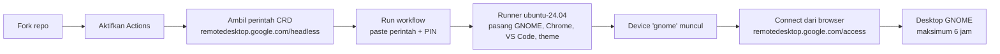

<p align="center">
  
</p>

<p align="center">
  <a href="https://github.com/ArchDityaa/gnome-crd/actions/workflows/lint.yml"></a>
  <a href="https://github.com/ArchDityaa/gnome-crd/blob/main/LICENSE"></a>
  
  
  
  
</p>

Jalankan **desktop GNOME lengkap** di cloud, gratis, hanya dengan **fork repo ini**.
Akses dari browser lewat Chrome Remote Desktop — tanpa install apa pun di komputer Anda.

[English version →](README.en.md)

Cocok untuk:

- Eksperimen desktop environment GNOME (extensions, theme, tata letak)
- Menguji / menjalankan tools GUI (VS Code, Chrome, virt-manager, GNOME Boxes)
- Uji coba aplikasi Linux di lingkungan bersih, sekali pakai
- Belajar terminal & Linux tanpa mengorbankan mesin sendiri

## Alur singkat



---

## Apa yang Anda dapatkan

Satu virtual machine **Ubuntu 24.04** (4 vCPU / 16 GB RAM) dengan desktop GNOME
yang sudah dikonfigurasi, hidup sampai **6 jam**, lalu otomatis mati. Setiap run
adalah lingkungan bersih — selesai, hilang.

| Sudah terpasang | Keterangan |
|---|---|
| **GNOME Desktop** | Sesi penuh (`ubuntu` GNOME session), bukan XFCE |
| **Google Chrome** | Bisa langsung dipakai login akun Google |
| **VS Code** | `code` |
| **OpenCode CLI + Desktop** | CLI di `/usr/local/bin/opencode`, plus app desktop |
| **Chrome Remote Desktop** | Jalur akses utamanya |
| **virt-manager + GNOME Boxes + libvirt/QEMU** | Untuk menjalankan VM di dalamnya (nested) |
| **Catppuccin Macchiato + Mauve** | Theme GTK/Shell, ikon Papirus, kursor, font JetBrainsMono Nerd Font |
| **safe-upgrade** | Pengganti `apt upgrade` yang tidak memutus sesi |

Plus: timezone **WIB (Asia/Jakarta)**, screensaver & lock dimatikan, animasi GNOME
dihidupkan pada software rendering, wallpaper Catppuccin, dan shortcut di Desktop.

---

<!-- SCREENSHOTS: blok ini sengaja dikomentari sampai gambar asli tersedia.
     Cara mengambil dan mengunggah gambar: docs/adding-screenshots.md
     Setelah file tersedia di docs/images/, hapus baris pembuka komentar ini
     beserta baris penutupnya.

## Tangkapan layar

<p align="center">
  
  <br><em>Desktop GNOME — Catppuccin Macchiato + Mauve</em>
</p>

<p align="center">
  
  
  <br><em>Overview (animasi aktif) dan aplikasi yang sudah terpasang</em>
</p>

<p align="center">
  
  <br><em><code>sudo safe-upgrade</code> — upgrade tanpa memutus sesi</em>
</p>

-->

## Persyaratan

- Akun **GitHub** (gratis). Runner publik = menit Actions tidak terbatas.
- Akun **Google** (untuk Chrome Remote Desktop).
- Browser Chrome/Chromium (untuk membuka halaman Remote Access).

Tidak perlu kartu kredit, tidak perlu server, tidak perlu self-hosted runner.

---

## Cara pakai (5 langkah)

### 1. Fork repo ini

Klik tombol **Fork** di kanan atas → **Create fork**.

### 2. Aktifkan Actions di fork Anda

**Ini langkah yang paling sering terlewat.** GitHub menonaktifkan workflow pada
repo hasil fork.

> **Settings** → **Actions** → **General** → pilih **Allow all actions and reusable
> workflows** → **Save**.

### 3. Ambil perintah Chrome Remote Desktop

1. Buka <https://remotedesktop.google.com/headless> (login akun Google Anda).
2. Klik **Begin** → **Next** → **Authorize**.
3. Di bagian **"Set up another computer" / "Debian Linux"**, copy **SELURUH**
   perintah yang muncul. Bentuknya seperti:

   ```bash
   DISPLAY= /opt/google/chrome-remote-desktop/start-host --code="4/0Ab..." --redirect-url="https://remotedesktop.google.com/_/oauthredirect" --name=$(hostname)
   ```

   > **Penting:** kode `--code=...` bersifat **sekali pakai** dan cepat kadaluarsa.
   > Jangan buka langkah 4 dulu setelah ini; langsung paste dan jalankan.

### 4. Jalankan workflow

1. Buka tab **Actions** di fork Anda.
2. Pilih **RICH LINUX (GNOME + Chrome Remote Desktop)** di sidebar kiri.
3. Klik **Run workflow** (kanan atas).
4. Paste seluruh perintah dari langkah 3 ke kolom **crd_host_command**.
5. Klik **Run workflow** (hijau).

**Opsional — ganti PIN:** buat secret `CRD_PIN` di
**Settings → Secrets and variables → Actions → New repository secret**
(nilai: minimal 6 digit). Kalau tidak diisi, PIN default `123456`.

### 5. Tunggu & connect

Instalasi butuh **±20–40 menit** (run pertama paling lama; run berikutnya lebih
cepat karena cache `.deb`). Setelah log muncul:

```
[OK] CHROME REMOTE DESKTOP READY
```

buka <https://remotedesktop.google.com/access>, pilih device bernama **gnome**,
lalu masukkan PIN.

| | |
|---|---|
| **User** | `runner` (password: `root`) |
| **PIN** | `123456` (atau secret `CRD_PIN` Anda) |
| **Device** | `gnome` |
| **Durasi** | sampai ±6 jam, lalu VM dimatikan otomatis |

---

## Setelah terhubung

- **Terminal:** tekan <kbd>Super</kbd> → cari *Terminal*, atau icon di dash.
- **Upgrade paket dengan aman:**

  ```bash
  sudo safe-upgrade
  ```

  Ada juga shortcut **Safe Upgrade** di Desktop. **Jangan** pakai
  `sudo apt upgrade -y` polos — itu bisa me-restart Chrome Remote Desktop dan
  memutus sesi Anda.
- **Menjalankan VM (KVM):** `virt-manager` atau **GNOME Boxes**. Runner x86
  punya KVM, jadi VM berjalan dengan akselerasi hardware.
- **Theme:** Catppuccin Macchiato (Mauve) sudah aktif. Ganti via **Tweaks** →
  Appearance kalau ingin variasi lain.

---

## Batasan & catatan penting

- **Maksimal 6 jam per run.** Ini batas job GitHub-hosted. Rencanakan pekerjaan
  Anda; simpan hasil ke GitHub/cloud, karena VM akan hilang setelahnya.
- **Instance sekali pakai.** Tidak ada penyimpanan permanen antar-run.
- **Gunakan sesuai ToS GitHub Actions.** GitHub mengizinkan Actions untuk
  *production, testing, deployment, atau publication* software. Repo ini
  ditujukan untuk **eksperimen dan pengujian tools**; jangan dipakai sebagai
  hosting/komputasi umum atau untuk penambangan kripto.
- **Keamanan kredensial:**
  - Perintah `crd_host_command` terlihat di metadata run (kode `--code=...`
    hanya sekali pakai, jadi risikonya kecil). Jika tidak nyaman, jadikan fork
    Anda **private** (Actions privat memakai kuota menit gratis Anda).
  - Ganti PIN default `123456`. Akses CRD tetap butuh login akun Google Anda,
    tapi PIN kuat tetap disarankan.
- **Hemat:** repo hasil fork tidak akan menerima update otomatis. Gunakan
  tombol **Sync fork** di GitHub untuk mengambil perbaikan terbaru.

---

## Troubleshooting singkat

| Masalah | Penyebab & solusi |
|---|---|
| Workflow tidak muncul di tab Actions | Fork belum meng-*enable* Actions → **Settings → Actions → General → Allow all actions**. |
| Run gagal di step *Register Chrome Remote Desktop* | Kode OAuth sudah kadaluarsa/terpakai. Ambil perintah **baru** di <https://remotedesktop.google.com/headless>, lalu **Re-run** workflow ini (cache `.deb` membuat re-run jauh lebih cepat). |
| Device tidak muncul di daftar Remote Access | Tunggu sampai log `[OK] CHROME REMOTE DESKTOP READY` muncul. Kalau masih tidak ada, refresh halaman dan cek service: `systemctl status chrome-remote-desktop@runner`. |
| Sesi terputus saat update paket | Anda memakai `apt upgrade` polos. Pakai `sudo safe-upgrade`. |
| Resolusi aneh / layar kecil | Dikunci ke `1024x768` (mode native driver `dummy`). Ubah lewat *Settings → Displays* bila perlu. |
| `virt-manager`: "Permission denied" pada libvirt | Log-out lalu log-in ulang di sesi GNOME, atau jalankan VM lewat GNOME Boxes. |
| `Cannot access KVM` | KVM tersedia di runner x86. Cek `ls -l /dev/kvm`; jika ada tapi tetap gagal, tulis issue dengan log run. |

Panduan lengkap: [`docs/troubleshooting.md`](docs/troubleshooting.md) ·
Pertanyaan umum: [`docs/faq.md`](docs/faq.md) ·
Cara menambah screenshot: [`docs/adding-screenshots.md`](docs/adding-screenshots.md)

---

## Struktur repo

```
.
├── .github/
│   ├── workflows/
│   │   ├── gnome.yml            # workflow utama (yang Anda jalankan)
│   │   └── lint.yml             # CI: actionlint + yamllint + shellcheck
│   ├── ISSUE_TEMPLATE/
│   └── dependabot.yml
├── scripts/
│   └── safe-upgrade.sh          # helper anti-putus-sesi
├── docs/
│   ├── images/banner.svg
│   ├── adding-screenshots.md
│   ├── troubleshooting.md
│   └── faq.md
├── .yamllint.yml                # konfigurasi linter YAML
├── README.md                    # dokumen ini (ID)
├── README.en.md                 # English
├── CHANGELOG.md
└── LICENSE
```

---

## Kontribusi

Pull request sangat diterima. Semua YAML, workflow, dan skrip divalidasi otomatis
oleh CI **Lint** pada setiap push ke `main` dan setiap pull request.

Jalankan linter yang sama secara lokal sebelum push:

```bash
pip install yamllint
yamllint .
shellcheck scripts/*.sh
# actionlint: https://github.com/rhysd/actionlint
actionlint -ignore SC2016 -ignore SC2034 -ignore SC2012
```

---

## Kredit

- [Catppuccin](https://github.com/catppuccin) — theme GTK, kursor, terminal, wallpaper
- [Papirus](https://github.com/PapirusDevelopmentTeam/papirus-icon-theme) — icon theme
- [Nerd Fonts](https://github.com/ryanoasis/nerd-fonts) — JetBrainsMono
- Google Chrome Remote Desktop

Lisensi: [MIT](LICENSE).
