<p align="center">
  
</p>

<p align="center">
  <a href="https://github.com/ArchDityaa/gnome-crd/actions/workflows/lint.yml"></a>
  <a href="https://github.com/ArchDityaa/gnome-crd/blob/main/LICENSE"></a>
  
  
  
  
</p>

Jalankan **desktop GNOME lengkap** di cloud, gratis, hanya dengan **fork repo ini**.
Akses dari browser lewat Chrome Remote Desktop — tanpa install apa pun di komputer Anda.

[English version →](README.en.md)

Cocok untuk:

- Eksperimen desktop environment GNOME (extensions, theme, tata letak)
- Menguji / menjalankan tools GUI (VS Code, Chrome, virt-manager, GNOME Boxes)
- Uji coba aplikasi Linux di lingkungan bersih, sekali pakai
- Belajar terminal & Linux tanpa mengorbankan mesin sendiri

## Alur singkat

```mermaid
flowchart LR
  A[Fork repo] --> B[Aktifkan Actions]
  B --> C[Run workflow<br/>tanpa input auth]
  C --> D[Runner ubuntu-26.04<br/>pasang GNOME atau Cinnamon, Chrome, VS Code, theme]
  D --> E[Workflow tampilkan URL form<br/>Cloudflare quick tunnel]
  E --> F[Buka URL lalu authorize<br/>di remotedesktop.google.com/headless]
  F --> G[Paste perintah Debian<br/>ke form web]
  G --> H[Device 'gnome' / 'cinnamon' terdaftar]
  H --> I[Connect dari browser<br/>remotedesktop.google.com/access]
  I --> J[Desktop GNOME / Cinnamon<br/>maksimum 6 jam]
```



> **Penting:** kode auth Chrome Remote Desktop **tidak lagi diambil di awal**.
> Workflow menunggu desktop siap, baru menampilkan form web. Kode yang Anda buat
> setelah itu langsung dipakai, jadi tidak kedaluwarsa selama instalasi.

---

## Apa yang Anda dapatkan

Satu virtual machine **Ubuntu 26.04** (4 vCPU / 16 GB RAM) dengan desktop
**GNOME** atau **Cinnamon** yang sudah dikonfigurasi, hidup sampai **6 jam**,
lalu otomatis mati. Setiap run adalah lingkungan bersih — selesai, hilang.

| Sudah terpasang | Keterangan |
|---|---|
| **GNOME Desktop** | Sesi penuh (`ubuntu` GNOME session), bukan XFCE — workflow `GNOME 26` |
| **Cinnamon Desktop** | Cinnamon 6.4 X11 + Nemo + Muffin — workflow `Cinnamon 26` |
| **Google Chrome** | Bisa langsung dipakai login akun Google |
| **VS Code** | `code` |
| **OpenCode CLI + Desktop** | CLI di `/usr/local/bin/opencode`, plus app desktop |
| **Chrome Remote Desktop** | Jalur akses utamanya |
| **virt-manager + libvirt/QEMU** | Untuk menjalankan VM di dalamnya (nested). GNOME juga menyertakan GNOME Boxes |
| **Catppuccin Macchiato + Mauve** | Theme GTK/Cinnamon Shell, ikon Papirus, kursor, font JetBrainsMono Nerd Font |
| **safe-upgrade** | Pengganti `apt upgrade` yang tidak memutus sesi |

Plus: timezone **WIB (Asia/Jakarta)**, screensaver & lock dimatikan, wallpaper
Catppuccin, dan shortcut di Desktop.

### Varian desktop

| | **GNOME 26** | **Cinnamon 26** |
|---|---|---|
| Workflow | `.github/workflows/gnome26.yml` | `.github/workflows/cinnamon.yml` |
| Desktop | GNOME (sesi `ubuntu`) | Cinnamon 6.4 (sesi `cinnamon`, X11) |
| Device CRD | `gnome` | `cinnamon` |
| File manager | Nautilus | Nemo |
| Catatan | Animasi dipaksa hidup lewat ekstensi | Animasi bisa tetap off karena Cinnamon mematikan efek saat software rendering (llvmpipe) |

Keduanya memakai runner `ubuntu-26.04`, user `runner`, dan alur otorisasi web yang
sama. Pilih salah satu workflow saat menjalankan Actions.

---

<!-- SCREENSHOTS: blok ini sengaja dikomentari sampai gambar asli tersedia.
     Cara mengambil dan mengunggah gambar: docs/adding-screenshots.md
     Setelah file tersedia di docs/images/, hapus baris pembuka komentar ini
     beserta baris penutupnya.

## Tangkapan layar

<p align="center">
  
  <br><em>Desktop GNOME — Catppuccin Macchiato + Mauve</em>
</p>

<p align="center">
  
  
  <br><em>Overview (animasi aktif) dan aplikasi yang sudah terpasang</em>
</p>

<p align="center">
  
  <br><em><code>sudo safe-upgrade</code> — upgrade tanpa memutus sesi</em>
</p>

-->

## Persyaratan

- Akun **GitHub** (gratis). Runner publik = menit Actions tidak terbatas.
- Akun **Google** (untuk Chrome Remote Desktop).
- Browser Chrome/Chromium (untuk membuka halaman Remote Access).
- Tidak perlu akun Cloudflare — tunnel quick dibuat otomatis oleh workflow.

Tidak perlu kartu kredit, tidak perlu server, tidak perlu self-hosted runner.

---

## Cara pakai (5 langkah)

### 1. Fork repo ini

Klik tombol **Fork** di kanan atas → **Create fork**.

### 2. Aktifkan Actions di fork Anda

**Ini langkah yang paling sering terlewat.** GitHub menonaktifkan workflow pada
repo hasil fork.

> **Settings** → **Actions** → **General** → pilih **Allow all actions and reusable
> workflows** → **Save**.

### 3. Jalankan workflow (tanpa input auth)

1. Buka tab **Actions** di fork Anda.
2. Pilih **GNOME 26** atau **Cinnamon 26** di sidebar kiri.
3. Klik **Run workflow** (kanan atas).
4. Biarkan kolom **crd_host_command** **kosong** — kolom itu hanya fallback.
5. Klik **Run workflow** (hijau).

**Opsional — ganti PIN:** buat secret `CRD_PIN` di
**Settings → Secrets and variables → Actions → New repository secret**
(nilai: minimal 6 digit). Kalau tidak diisi, PIN default `123456`.

### 4. Buka form otorisasi & authorize

Setelah instalasi selesai (**±20–40 menit**), log akan menampilkan:

```
[OK] FORM OTORISASI SIAP
```

URL form juga muncul di **Job Summary** run tersebut. Buka URL itu (bisa dari HP
atau jaringan lain). Kalau muncul error Cloudflare **1033/502**, tunggu ±15 detik
lalu refresh — tunnel sedang warm-up.

Lalu:

1. Di tab lain, buka <https://remotedesktop.google.com/headless> dan login akun
   Google Anda.
2. Klik **Begin** → **Next** → **Authorize**.
3. Di bagian **"Set up another computer" / "Debian Linux"**, copy **SELURUH**
   perintah yang muncul. Bentuknya seperti:

   ```bash
   DISPLAY= /opt/google/chrome-remote-desktop/start-host --code="4/0Ab..." --redirect-url="https://remotedesktop.google.com/_/oauthredirect" --name=$(hostname)
   ```

4. Paste perintah itu ke form, lalu submit.

Form menampilkan status secara live. Kalau registrasi gagal (kode salah,
kedaluwarsa, atau sudah terpakai), **ambil kode BARU** di halaman headless lalu
submit lagi ke form yang sama — **tidak perlu re-run workflow** selama window
30 menit masih berjalan.

> **Jangan bagikan URL form.** URL itu mengandung token acak dan berlaku sebagai
> kredensial sementara selama ±30 menit.

### 5. Tunggu & connect

Setelah log menunjukkan:

```
[OK] CHROME REMOTE DESKTOP READY
```

buka <https://remotedesktop.google.com/access>, pilih device bernama **gnome**
(workflow GNOME) atau **cinnamon** (workflow Cinnamon), lalu masukkan PIN.

| | |
|---|---|
| **User** | `runner` (password: `root`) |
| **PIN** | `123456` (atau secret `CRD_PIN` Anda) |
| **Device** | `gnome` / `cinnamon` (sesuai workflow) |
| **Durasi** | sampai ±6 jam, lalu VM dimatikan otomatis |

> Workflow lama **`gnome.yml`** (RICH LINUX, Ubuntu 24.04) memakai alur lama:
> ambil perintah CRD **sebelum** run, lalu paste ke input `crd_host_command`.
> Untuk alur terbaru, gunakan **GNOME 26** atau **Cinnamon 26**.

---

## Setelah terhubung

- **Terminal:** tekan <kbd>Super</kbd> → cari *Terminal*, atau icon di panel/dash.
- **File manager:** Nautilus di GNOME, **Nemo** di Cinnamon.
- **Upgrade paket dengan aman:**

  ```bash
  sudo safe-upgrade
  ```

  Ada juga shortcut **Safe Upgrade** di Desktop. **Jangan** pakai
  `sudo apt upgrade -y` polos — itu bisa me-restart Chrome Remote Desktop dan
  memutus sesi Anda.
- **Menjalankan VM (KVM):** `virt-manager` (kedua varian), atau **GNOME Boxes**
  di varian GNOME. Runner x86 punya KVM, jadi VM berjalan dengan akselerasi hardware.
- **Theme:** Catppuccin Macchiato (Mauve) sudah aktif. Di Cinnamon, ganti lewat
  **Themes** → *Desktop*; kalau `cinnamon.css` bermasalah, kembalikan tema bawaan
  dengan `gsettings set org.cinnamon.theme name ''`.

---

## Batasan & catatan penting

- **Maksimal 6 jam per run.** Ini batas job GitHub-hosted. Rencanakan pekerjaan
  Anda; simpan hasil ke GitHub/cloud, karena VM akan hilang setelahnya.
- **Instance sekali pakai.** Tidak ada penyimpanan permanen antar-run.
- **Window otorisasi 30 menit.** Setelah desktop siap, form web hanya menerima
  perintah selama 30 menit. Kalau habis, workflow gagal dan perlu dijalankan
  ulang (cache `.deb` membuat re-run lebih cepat).
- **Cloudflare quick tunnel tidak punya SLA.** URL-nya acak dan bisa perlu
  di-refresh saat pertama dibuka. Kalau tunnel mati, workflow mencoba restart
  hingga 3 kali dan menampilkan URL baru.
- **Gunakan sesuai ToS GitHub Actions.** GitHub mengizinkan Actions untuk
  *production, testing, deployment, atau publication* software. Repo ini
  ditujukan untuk **eksperimen dan pengujian tools**; jangan dipakai sebagai
  hosting/komputasi umum atau untuk penambangan kripto.
- **Keamanan kredensial:**
  - URL form mengandung **token acak 128-bit**. Siapa pun yang membuka URL itu
    selama window 30 menit bisa mengirim perintah registrasi. **Jangan
    bagikan URL**, dan tutup tab form setelah selesai.
  - Di repo **publik**, log dan **Job Summary** juga terlihat oleh siapa saja
    selama run. Kalau ini tidak nyaman, gunakan **fork private**.
  - Kode OAuth (`--code=...`) tetap **sekali pakai**. Kode dibuat setelah desktop
    siap, jadi tidak kedaluwarsa selama instalasi.
  - Input `crd_host_command` adalah **fallback opsional**. Kalau diisi di awal
    run, kodenya bisa kedaluwarsa saat registrasi; utamakan form web.
  - Ganti PIN default `123456`. Akses CRD tetap butuh login akun Google Anda,
    tapi PIN kuat tetap disarankan.
- **Hemat:** repo hasil fork tidak akan menerima update otomatis. Gunakan
  tombol **Sync fork** di GitHub untuk mengambil perbaikan terbaru.

---

## Troubleshooting singkat

| Masalah | Penyebab & solusi |
|---|---|
| Workflow tidak muncul di tab Actions | Fork belum meng-*enable* Actions → **Settings → Actions → General → Allow all actions**. |
| URL form tidak muncul | Cek log step **Authorize & Register Chrome Remote Desktop (Web UI)**. Kalau ada `[FAIL] Cloudflare quick tunnel tidak bisa dibuat`, jalankan ulang workflow (cache `.deb` terpakai), atau jalankan ulang dengan mengisi `crd_host_command` sebagai fallback memakai kode yang masih baru. |
| Halaman form menampilkan error Cloudflare 1033/502 | Tunnel sedang warm-up. Tunggu ±15 detik lalu refresh. Kalau tetap gagal, tunggu URL baru dari log (workflow restart tunnel otomatis). |
| Registrasi via form gagal | Kode OAuth sudah kedaluwarsa/terpakai. Ambil perintah **baru** di <https://remotedesktop.google.com/headless>, lalu submit lagi ke form yang sama. Tidak perlu re-run selama window 30 menit. |
| Window 30 menit habis | Workflow berhenti. Jalankan ulang; cache `.deb` membuat instalasi jauh lebih cepat. |
| Device tidak muncul di daftar Remote Access | Tunggu sampai log `[OK] CHROME REMOTE DESKTOP READY` muncul. Kalau masih tidak ada, refresh halaman dan cek service: `systemctl status chrome-remote-desktop@runner`. |
| Sesi terputus saat update paket | Anda memakai `apt upgrade` polos. Pakai `sudo safe-upgrade`. |
| Resolusi aneh / layar kecil | Dikunci ke `1024x768` (mode native driver `dummy`). Ubah lewat *Settings → Displays* bila perlu. |
| `virt-manager`: "Permission denied" pada libvirt | Log-out lalu log-in ulang di sesi desktop, atau jalankan VM lewat GNOME Boxes (varian GNOME). |
| Cinnamon: layar hitam setelah connect | Coba fallback `cinnamon2d`: ubah baris `exec` di `~/.chrome-remote-desktop-session` menjadi `exec /usr/bin/cinnamon-session --session cinnamon2d`, lalu restart `chrome-remote-desktop@runner`. |
| Cinnamon: animasi tidak jalan | Normal pada sesi CRD: Cinnamon 6.4 mematikan efek saat mendeteksi software rendering (llvmpipe). Tidak ada override seperti `force_animations` di GNOME Shell. |
| `Cannot access KVM` | KVM tersedia di runner x86. Cek `ls -l /dev/kvm`; jika ada tapi tetap gagal, tulis issue dengan log run. |

Panduan lengkap: [`docs/troubleshooting.md`](docs/troubleshooting.md) ·
Pertanyaan umum: [`docs/faq.md`](docs/faq.md) ·
Cara menambah screenshot: [`docs/adding-screenshots.md`](docs/adding-screenshots.md)

---

## Struktur repo

```
.
├── .github/
│   ├── workflows/
│   │   ├── gnome26.yml          # workflow utama GNOME (form otorisasi web)
│   │   ├── cinnamon.yml         # workflow Cinnamon 26 (X11, device 'cinnamon')
│   │   ├── gnome.yml            # workflow lama (input command di awal)
│   │   └── lint.yml             # CI: actionlint + yamllint + shellcheck
│   ├── ISSUE_TEMPLATE/
│   └── dependabot.yml
├── scripts/
│   ├── crd-web-auth.py          # server form otorisasi (token + status)
│   └── safe-upgrade.sh          # helper anti-putus-sesi
├── docs/
│   ├── images/banner.svg
│   ├── adding-screenshots.md
│   ├── troubleshooting.md
│   └── faq.md
├── .yamllint.yml                # konfigurasi linter YAML
├── README.md                    # dokumen ini (ID)
├── README.en.md                 # English
├── CHANGELOG.md
└── LICENSE
```

---

## Kontribusi

Pull request sangat diterima. Semua YAML, workflow, dan skrip divalidasi otomatis
oleh CI **Lint** pada setiap push ke `main` dan setiap pull request.

Jalankan linter yang sama secara lokal sebelum push:

```bash
pip install yamllint
yamllint .
shellcheck scripts/*.sh
python3 -m py_compile scripts/crd-web-auth.py
# actionlint: https://github.com/rhysd/actionlint
actionlint -ignore SC2016 -ignore SC2034 -ignore SC2012 \
  -ignore 'label "ubuntu-26.04" is unknown'
```

---

## Kredit

- [Catppuccin](https://github.com/catppuccin) — theme GTK, kursor, terminal, wallpaper
- [Papirus](https://github.com/PapirusDevelopmentTeam/papirus-icon-theme) — icon theme
- [Nerd Fonts](https://github.com/ryanoasis/nerd-fonts) — JetBrainsMono
- Google Chrome Remote Desktop

Lisensi: [MIT](LICENSE).
