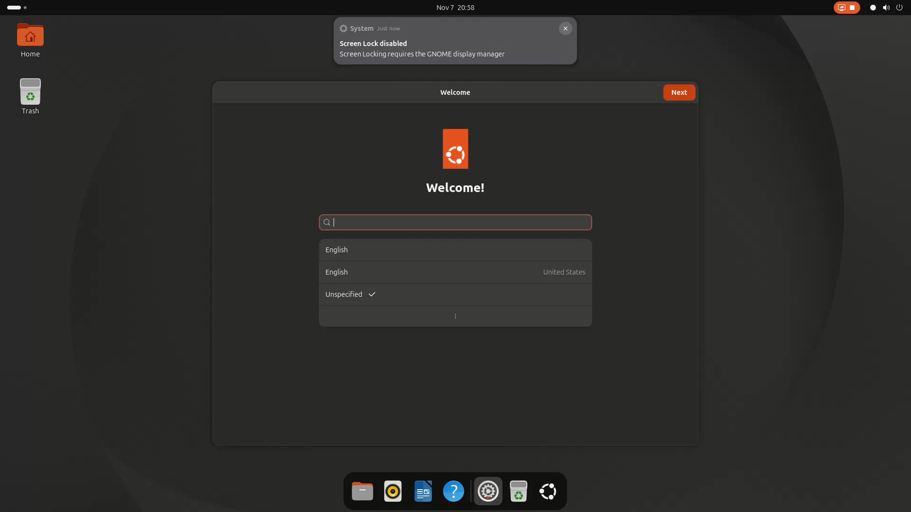
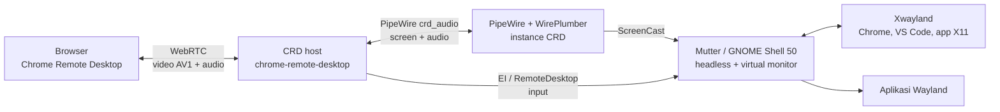

# GNOME 26 Wayland di Chrome Remote Desktop — Terverifikasi

**Status: TERVERIFIKASI — 7 November 2026.**
Sesi **GNOME Shell 50.1 Wayland headless** di Ubuntu 26.04 berhasil diakses lewat
**Chrome Remote Desktop 157** secara mulus: video **AV1 ±60 fps**, audio lewat
PipeWire, input keyboard/mouse, dan animasi desktop aktif.

> Mode Wayland di Chrome Remote Desktop masih **eksperimental di sisi upstream**.
> Dokumen ini mencatat konfigurasi yang terbukti bekerja, bukti pengujian, dan
> batasannya — bukan klaim bahwa seluruh kombinasi klien/jaringan akan identik.

| Item | Detail |
|---|---|
| Workflow | [`.github/workflows/gnome26-wayland-beta.yml`](../.github/workflows/gnome26-wayland-beta.yml) |
| Run bukti | [42378799566](https://github.com/ArchDityaa/gnome-crd/actions/runs/42378799566) |
| Commit | [`31c0baa`](https://github.com/ArchDityaa/gnome-crd/commit/31c0baa) |
| Tanggal uji | 7 November 2026, 20:50 WIB |
| Device CRD | `gnome` |

---

## 1. Ringkasan hasil

| Aspek | Hasil | Catatan |
|---|---|---|
| Desktop | GNOME Shell **50.1** Wayland headless | Virtual monitor `1920x1080` |
| Akses | Chrome Remote Desktop **157.0.8103.19** | Mode `CHROME_REMOTE_DESKTOP_USE_WAYLAND=GNOME` |
| Codec video | **AV1** | Teramati di klien CRD; negosiasi adaptif |
| Frame rate | **±60 fps** | Diamati pada Wi-Fi 5G; tergantung klien/jaringan |
| Audio | Didukung | PipeWire CRD, sink `chrome_remote_desktop_session` |
| Input | Keyboard + mouse | Mutter RemoteDesktop / EI |
| Animasi | Aktif dan mulus | `global.force_animations`, `slow_down_factor=2.5` |
| Tampilan | Ubuntu dark | Wallpaper `ubuntu-wallpaper-d.png`, ikon/kursor Yaru, font Ubuntu Sans |
| Runner | `ubuntu-26.04` | Ubuntu 26.04.1 LTS (Resolute Raccoon) |

**Versi lingkungan uji:**

| Komponen | Versi |
|---|---|
| Ubuntu | 26.04.1 LTS |
| GNOME Shell | 50.1-0ubuntu1.5 |
| Mutter | 50.1-0ubuntu2.5 |
| Chrome Remote Desktop | 157.0.8103.19 |
| PipeWire | 1.6.2-1ubuntu1.2 |

> AV1, ±60 fps, dan kelancaran animasi adalah **hasil pengamatan pengguna** pada
> sesi uji di atas. CRD memilih codec/frame rate secara adaptif; jaringan,
> perangkat klien, dan beban CPU runner dapat mengubah hasilnya.

---

## 2. Bukti

Frame berikut direkam otomatis oleh workflow (step *Capture desktop proof*)
tepat setelah verifikasi, melalui `org.gnome.Shell.Screencast` — jalur terpisah
dari stream CRD. Dialog **Welcome** GNOME masih terbuka karena ini sesi baru;
di baliknya terlihat wallpaper Ubuntu dark, dock, dan desktop yang sudah
dirender oleh compositor Wayland.



Bukti pendukung:

- Run: <https://github.com/ArchDityaa/gnome-crd/actions/runs/42378799566>
- Artifact: `desktop-proof-42378799566` (PNG 1920x1080 + WebM)
- Log workflow menandai `[OK] CHROME REMOTE DESKTOP READY`,
  `[OK] Wallpaper + tampilan default Ubuntu`, dan `[HEARTBEAT]` keep-alive.

> Artifact GitHub hanya disimpan 3 hari; gambar di atas sudah dikomit agar bukti
> tetap ada.

---

## 3. Arsitektur



Alur singkat:

1. systemd user unit menjalankan
   `gnome-shell --mode=ubuntu --wayland --headless --virtual-monitor 1920x1080`.
2. Drop-in CRD menyalakan mode Wayland:
   `CHROME_REMOTE_DESKTOP_USE_WAYLAND=GNOME`, `XDG_SESSION_TYPE=wayland`,
   serta software rendering (`LIBGL_ALWAYS_SOFTWARE=1`).
3. CRD menjalankan `gnome-session --session=ubuntu`; shell membuat satu virtual
   monitor dan meng-*export* `WAYLAND_DISPLAY` ke systemd user.
4. Mutter menyediakan **ScreenCast** (video) dan **RemoteDesktop/EI** (input)
   lewat API privat GNOME. CRD mengonsumsinya melalui instance PipeWire
   `crd_audio`.
5. CRD mengirim video/audio ke browser lewat WebRTC; codec video dinegosiasikan
   otomatis (AV1 bila klien mendukung).
6. Aplikasi X11 (Chrome, VS Code) berjalan lewat Xwayland; aplikasi Wayland
   native berjalan langsung di shell.

---

## 4. Apa yang membuat ini berhasil

### 4.1 Mode Wayland CRD

Ubuntu 26.04/GNOME 50 tidak lagi menyediakan sesi X11. Workflow karena itu
memakai mode Wayland eksperimental CRD:

```
CHROME_REMOTE_DESKTOP_USE_WAYLAND=GNOME
```

CRD memanggil `gnome-session`, menunggu socket Wayland aktif, lalu menyalakan
host-nya. Wrapper `/usr/local/bin/gnome-session` memastikan sesi `ubuntu`
dipakai (bukan `gnome` yang tidak punya mode shell di Ubuntu 26.04).

### 4.2 Converter video PipeWire

Instance PipeWire milik CRD (`crd_audio`) pada awalnya hanya memetakan
`audio.convert` di `context.spa-libs`. Akibatnya, ketika format video Mutter dan
consumer CRD berbeda, link bisa gagal dengan:

```
pipewire remote error: id:2 no more input formats
```

Workflow menambahkan mapping standar ke template CRD sebelum host dijalankan:

```
video.convert.* = videoconvert/libspa-videoconvert
```

Dengan converter tersedia, PipeWire dapat menyisipkan adapter dan negosiasi
video tidak lagi gagal.

### 4.3 Tampilan Ubuntu eksplisit lewat dconf

CRD memaksa `XDG_CURRENT_DESKTOP=GNOME` untuk sesi GNOME Wayland. Artinya
override Ubuntu (`[org.gnome.desktop.background:ubuntu]` dan
`[org.gnome.desktop.interface:ubuntu]`) **tidak** dipakai. Tanpa penanganan,
`picture-uri(-dark)` jatuh ke `adwaita-*.jxl` yang tidak terpasang dan layar
menjadi biru solid `#023c88`.

Workflow menulis `/etc/dconf/db/local.d/96-crd-ubuntu-look`:

- `picture-uri` → `warty-final-ubuntu.png` (light)
- `picture-uri-dark` → `ubuntu-wallpaper-d.png` (dark)
- `primary-color` / `secondary-color` → `#2c001e` (fallback aubergine, bukan biru)
- `icon-theme` / `cursor-theme` → `Yaru`
- `font-name` → `Ubuntu Sans 11`, `document-font-name` → `Sans 11`,
  `monospace-font-name` → `Ubuntu Sans Mono 11`

Ditambah `97-crd-dark-mode` untuk `color-scheme='prefer-dark'` dan
`gtk-theme='Yaru-dark'`.

### 4.4 Animasi di software rendering

Mutter mendeteksi rendering software (llvmpipe) dan menonaktifkan animasi.
Workflow memasang ekstensi `force-animations@software-rendering` yang menyetel
`global.force_animations = true` dari dalam shell, dengan
`slow_down_factor=2.5`. Hasilnya animasi overview/minimize/workspace tetap
berjalan mulus walau tanpa GPU.

### 4.5 Watchdog crash EI

Chrome Remote Desktop dapat mati dengan fatal error bila sesi EI Mutter hilang:

```
FATAL remoting/host/linux/gnome_remote_desktop_session.cc:319
Failed to reconnect to EI session:
Object does not exist at path /org/gnome/Mutter/RemoteDesktop/Session/...
```

Keep-alive memantau `/run/user/<uid>/crd_crashpad/completed/*.dmp`. Bila muncul
dump baru, workflow mencatat insiden dan me-restart
`chrome-remote-desktop@runner` (maksimal sekali per 2 menit), sehingga capture
bisa pulih tanpa re-run.

### 4.6 Verifikasi yang tidak menipu

Step *Verify Installation* memeriksa hal yang benar-benar dikontrol workflow:

- file wallpaper benar-benar ada di disk (bukan sekadar string URI);
- nilai `picture-uri`/`picture-uri-dark` sesuai;
- ikon/kursor/font = Yaru/Ubuntu Sans;
- `color-scheme` = `prefer-dark`, `gtk-theme` = `Yaru-dark`;
- service CRD aktif dan socket Wayland ada.

`XDG_CURRENT_DESKTOP=GNOME` hanya dicetak sebagai info — itu memang dipaksa CRD,
bukan indikator wallpaper.

---

## 5. Video, codec, dan performa

- **AV1**: CRD/WebRTC menegosiasikan codec terbaik yang didukung kedua sisi.
  Pada sesi uji, klien memakai AV1. Bila klien/CPU tidak mendukung AV1, CRD akan
  memakai codec lain yang tersedia (mis. VP8/VP9/H.264) — kualitas dan fps
  mengikuti negosiasi.
- **±60 fps**: teramati di Wi-Fi 5G. Faktor yang memengaruhi: bandwidth dan
  latency jaringan, kemampuan decode klien, resolusi 1920x1080, serta beban CPU
  runner (rendering software).
- **Software rendering**: runner tanpa GPU memakai llvmpipe. Karena itu
  `LIBGL_ALWAYS_SOFTWARE=1`/`MUTTER_DEBUG_FORCE_SOFTWARE_RENDER=1` diset dan
  animasi dipaksa aktif lewat ekstensi.
- **Resolusi**: virtual monitor tetap `1920x1080` (bukan resolusi dinamis
  seperti jalur X11).

Tips bila fps turun: gunakan jaringan kabel/5G yang stabil, tutup tab berat di
klien, pastikan hardware acceleration browser aktif, dan hindari menjalankan
banyak aplikasi berat di sesi.

---

## 6. Audio

Audio memakai instance PipeWire milik CRD, terpisah dari PipeWire sistem:

| Variabel | Nilai |
|---|---|
| `PIPEWIRE_REMOTE` | `crd_audio/pipewire` |
| `PULSE_RUNTIME_PATH` | `/run/user/<uid>/crd_audio` |
| `PULSE_SINK` | `chrome_remote_desktop_session` |
| `CHROME_REMOTE_DESKTOP_AUDIO_PIPE` | `/run/user/<uid>/crd_audio/fifo_output` |

Alur: aplikasi (PipeWire/WirePlumber di sesi GNOME) → sink
`chrome_remote_desktop_session` → CRD host → WebRTC → browser.

Cek cepat **di dalam sesi** (Terminal GNOME):

```bash
pactl info | grep -E 'Server Name|Default Sink'
pw-link -l | grep chrome_remote_desktop_session
# mainkan suara uji
paplay /usr/share/sounds/ubuntu/stereo/bell.ogg
```

Dari host/workflow (di luar sesi):

```bash
sudo -u runner env \
  XDG_RUNTIME_DIR=/run/user/$(id -u runner) \
  PULSE_RUNTIME_PATH=/run/user/$(id -u runner)/crd_audio \
  PIPEWIRE_REMOTE=crd_audio/pipewire \
  pw-link -l
```

Jika belum terdengar:

1. Pastikan ikon **audio/speaker** di klien Chrome Remote Desktop tidak mute.
2. Cek volume di dalam desktop dan volume tab browser.
3. Pastikan `pactl info` menunjuk sink `chrome_remote_desktop_session`.
4. Lihat [troubleshooting #16](troubleshooting.md#16-audio-tidak-terdengar-di-wayland).

> Status audio: pipeline terpasang dan dipakai sesi. Verifikasi end-to-end
> bergantung pada klien (toggle audio) dan perangkat output Anda.

---

## 7. Cara menjalankan & memverifikasi

1. Jalankan workflow **GNOME 26 + CRD (Wayland BETA)** seperti biasa
   (lihat [README](../README.md#cara-pakai-5-langkah)).
2. Authorize lewat form web, lalu connect ke device `gnome`.
3. Setelah `[OK] CHROME REMOTE DESKTOP READY`, **tunggu ±1–2 menit** sebelum
   connect pertama agar host/EI dan PipeWire settle.
4. Jika layar sempat blank, tunggu 1–2 menit lalu reconnect — watchdog akan
   me-restart host bila terdeteksi crash.

Verifikasi di dalam sesi:

```bash
systemctl --user status org.gnome.Shell@ubuntu.service
pgrep -a gnome-shell
echo "$XDG_SESSION_TYPE"          # wayland
pw-link -l                        # link gnome-shell <-> chrome-remote-desktop-host
gsettings get org.gnome.desktop.background picture-uri-dark
gsettings get org.gnome.desktop.interface icon-theme
journalctl --user -u org.gnome.Shell@ubuntu.service -n 50 --no-pager
```

Di workflow, cari penanda:

- `[OK] CHROME REMOTE DESKTOP READY (WAYLAND BETA)`
- `[OK] Wallpaper + tampilan default Ubuntu (file ada, bukan Adwaita)`
- `[HEARTBEAT] ... shell PID ... portal-gnome: active`
- artifact `desktop-proof-<run_id>` untuk frame compositor.

---

## 8. Batasan & known issues

- **Mode Wayland CRD masih eksperimental upstream.** Perilaku bisa berubah
  antar versi CRD/Mutter/PipeWire.
- **Crash EI reconnect.** Bila objek
  `/org/gnome/Mutter/RemoteDesktop/Session/...` hilang (mis. setelah client
  disconnect), CRD dapat FATAL dan host mati. Workflow memitigasi dengan
  restart otomatis + pengamatan crash dump. Jika layar blank: tunggu,
  reconnect, atau jalankan ulang.
- **Negosiasi format video Mutter 50.** Beberapa consumer bisa gagal dengan
  `no more input formats`; mapping `video.convert` di PipeWire CRD membantu
  menyediakan adapter.
- **Batas 6 jam per run**, instance sekali pakai, dan virtual monitor tetap
  `1920x1080`.
- **AV1/60 fps tidak dijamin.** Adaptif terhadap klien, jaringan, dan CPU.
- **HDR belum didukung** pada kombinasi ini.
- **Dialog Welcome GNOME** muncul pada login pertama sesi baru; tutup dengan
  **Next/Skip** sebelum dipakai.
- **Audio perlu diaktifkan di klien** dan volume tidak mute.
- **Keamanan**: URL form mengandung token rahasia; PIN default sebaiknya
  diganti. Di repo publik, log dan Job Summary terlihat publik.

---

## 9. Referensi

- Chrome Remote Desktop — <https://remotedesktop.google.com/access>
- Mutter issue “PipeWire screencast: no more input formats” —
  <https://gitlab.gnome.org/GNOME/mutter/-/work_items/4759>
- PipeWire — <https://pipewire.org/>
- Dokumentasi internal: [FAQ](faq.md), [Troubleshooting](troubleshooting.md),
  [Adding screenshots](adding-screenshots.md)

---

## English summary

**Verified on 7 November 2026** (run
[42378799566](https://github.com/ArchDityaa/gnome-crd/actions/runs/42378799566)):
GNOME Shell 50.1 on Ubuntu 26.04 runs as a headless Wayland session and is
usable through Chrome Remote Desktop 157 with AV1 video at ~60 fps, PipeWire
audio, working input via Mutter RemoteDesktop/EI, and smooth animations on
software rendering.

Key pieces: `CHROME_REMOTE_DESKTOP_USE_WAYLAND=GNOME`, a headless
`gnome-shell --virtual-monitor 1920x1080`, the CRD PipeWire instance with a
`video.convert` mapping, explicit Ubuntu look via dconf (because CRD forces
`XDG_CURRENT_DESKTOP=GNOME`), the `force-animations@software-rendering`
extension, and a crash watchdog for the upstream EI reconnect bug.

Caveats: CRD's Wayland mode is still experimental upstream; AV1/60 fps are
adaptive and depend on the client and network; the session is limited to six
hours; and audio must be enabled in the client. See the Indonesian sections
above for the full architecture, audio pipeline, verification commands, and
troubleshooting.
